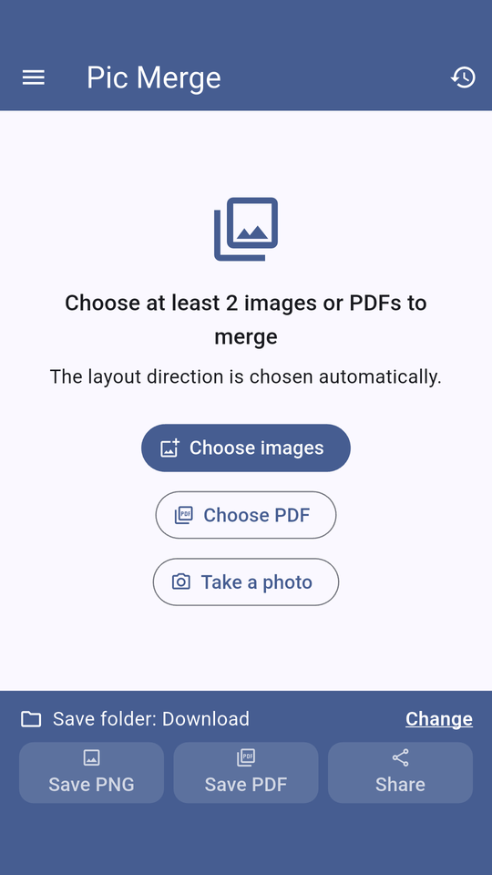
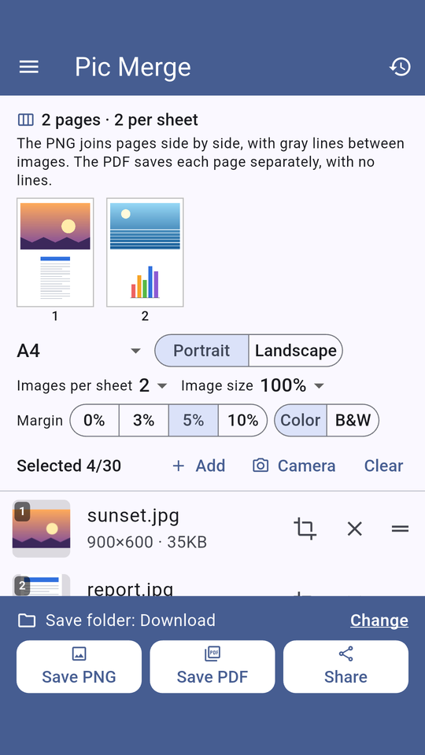
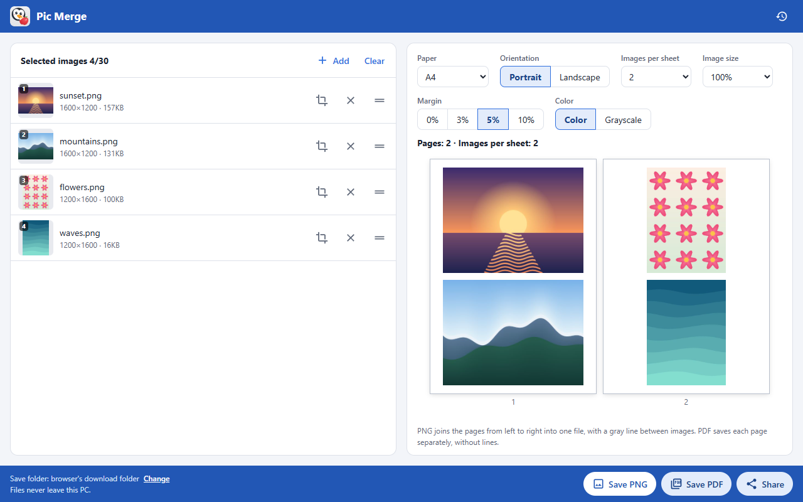

# Pic Merge

[](LICENSE)

**Combine multiple images and PDFs into a single PNG or PDF, right on your device.**

Pic Merge lays out your pages for you, so a few taps turn a pile of screenshots, photos or scans into one file that is ready to save or share. There is no account, no network access and no upload: every file stays on your device.

It runs on Android and as a Chrome extension. The iOS code is included but has not been built or tested yet. The app is not in any store yet, so you build it from source (see [Build and install](#build-and-install)).

## Screenshots

| Android: start screen | Android: settings and page preview |
|---|---|
|  |  |

**Chrome extension**



The screenshots use generated sample images.

## Features

- **Input**: 2 to 30 items from JPEG, PNG, WebP, HEIC/HEIF and PDF. Each PDF page becomes one item. On mobile you can also add a photo from the camera.
- **Arrange**: drag to reorder, crop each item, remove items.
- **Output settings**: paper, orientation, images per sheet, image size, margin and color. See [Output settings](#output-settings).
- **Save as PNG**: one image made of all the sheets joined together, with white margins and a light gray line between images. The app picks the joining direction from the paper shape.
- **Save as PDF**: one page per sheet, with the same margins and no lines.
- **Share**: send the file through the system share sheet to any app on your device.
- **Recent history**: the last 50 results and the success rate over the last 30 days.
- **Menu (mobile)**: the app version, terms of use and a way to send feedback from your mail app.
- **13 languages**: the app follows your device language. English, 한국어, 日本語, 简体中文, 繁體中文, Español, Français, Deutsch, Português, Русский, Tiếng Việt, Bahasa Indonesia and ไทย. Other languages fall back to English. The translations were made by AI and have not been reviewed by native speakers.

Result files never exceed 20 MB. Input images are limited to 4000 px on the long side and PNG canvases to 24 million pixels; anything larger is scaled down automatically.

## How to use

### Android

1. Tap **Choose images**, **Choose PDF** or **Take a photo**, and add at least 2 items.
2. Arrange the list: drag the handle to reorder, tap the crop icon to keep only part of an item, and tap **×** to remove it. Use **Add** and **Camera** to add more, or **Clear** to start over.
3. Choose the [output settings](#output-settings). The preview shows each sheet as you change them.
4. Tap **Save PNG** or **Save PDF**, or tap **Share** to send the file to another app.

Files are saved to your `Download` folder without asking. To use another folder, tap the save folder row and choose **Choose another folder**. **Use default folder** switches back. On Android 9 and below, the app asks you to choose a folder on the first save.

The menu button at the top left opens **About** (version and terms of use) and **Send feedback**. Send feedback opens your mail app with the address and an English subject filled in; you write and send the message yourself. The subject includes the app version, device model and OS version, and you can edit it.

### Chrome extension

1. Click the Pic Merge icon in the toolbar. The app opens in a new tab.
2. Click **Choose images or PDFs**, or drag files onto the page, and add at least 2 items.
3. Arrange the list and choose the [output settings](#output-settings).
4. Click **Save PNG** or **Save PDF**, or **Share** for more options.

Files go to the browser's download folder. Use **Change** in the save bar to pick another folder, and **Use default folder** to switch back. The camera and HEIC/HEIF are not available in the extension.

### Output settings

| Setting | Options | What it does |
|---|---|---|
| Paper | **A4**, A3, A5, B4, B5, Letter, Legal, Original size | The sheet size. Original size uses the images' own size with no sheet. |
| Orientation | **Portrait**, Landscape | How the sheet is held. Not used with Original size. |
| Images per sheet | **1**, 2, 3, 4, 6, 8, 9 | How many images go on each sheet. Not used with Original size. |
| Image size | **100%**, 50%, 30% | Image width and height relative to their largest fit in the cell. Not used with Original size. |
| Margin | 0%, 3%, **5%**, 10% | White space around each sheet, relative to its short side. The gap between images changes with it. |
| Color | **Color**, B&W (labeled Grayscale in Chrome) | B&W converts the output to shades of gray. |

Defaults are in bold. Settings return to these defaults each time you start the app.

### File names

Files are named `YYYYMMDDHHMI_n` from the local time, for example `202611052315_1.png`. A second save within the same minute becomes `202611052315_2.png`. If the name is taken by a file the app cannot see, Android or the browser may add its own number.

## Platform status

| Platform | Requires | Status |
|---|---|---|
| Android | Android 7.0 (API 24) or later; HEIC needs Android 9 or later | Checked on one phone. Load testing and testing across manufacturers are not done yet. |
| Chrome extension | Chrome 116 or later | Checked with automated end-to-end tests. The real share window, Compose email and the folder picker dialog have not been tried by hand yet. |
| iOS (iPhone only) | Mac and Xcode to build | **Unverified.** The code has never been compiled or run. Its default save location is the app's own folder, visible in the Files app, and is removed if you delete the app. |

## Privacy and permissions

There is no server, account, advertising or analytics SDK. The app works with no network connection. See the [privacy policy](PRIVACY.md).

- **Android**: does not request `INTERNET`, storage or `CAMERA` permissions. It uses the system Photo Picker, document picker, camera app, MediaStore and folder picker.
- **iOS**: the system asks for permission the first time you use the camera. Saving to another folder uses the system document picker.
- **Chrome extension**: `permissions` and `host_permissions` are empty, and no remote code is loaded.
- **Feedback**: the app never sends anything itself. Send feedback only opens your mail app.
- **History**: only metadata such as file names and sizes is kept, on your device. Original images and their paths are not stored.

## Build and install

### Android

You need Flutter 3.47.5 (Dart 3.13), Android SDK 36 and JDK 17.

```bash
git clone https://github.com/yncdev/os.picmerge.git
cd os.picmerge
flutter pub get
flutter run                  # run on a connected device
flutter build apk --release  # build/app/outputs/flutter-apk/app-release.apk
```

The repository holds no signing key, so release builds are signed with the debug key. To distribute your own build, use your own package ID and create `android/key.properties` with your [signing configuration](https://flutter.dev/to/reference-keystore). Never commit that file or your key.

### iOS

You need a Mac and Xcode. This has not been verified yet.

```bash
flutter build ios
```

### Chrome extension

1. Open `chrome://extensions` in Chrome.
2. Turn on **Developer mode** in the top right.
3. Click **Load unpacked** and select the `chromePlugin` folder.

More details are in [chromePlugin/README.md](chromePlugin/README.md) (in Korean).

## Tests

```bash
flutter test                     # Dart unit and widget tests
cd chromePlugin && node --test   # Chrome extension unit tests (checked on Node.js 24)
node tool/chrome_e2e/run.mjs     # Chrome extension end-to-end tests, from the repository root
```

The end-to-end tests use your installed Chrome with a temporary profile.

Native code tests:

```bash
# JVM tests. gradlew is created the first time you run flutter build apk.
cd android && ./gradlew :app:testDebugUnitTest

# On a connected device. Installs a separate .debug app and creates test files in Download.
flutter test integration_test/native_bridge_test.dart -d <device>
```

## Project structure

```
lib/
├── core/                 # Shared utilities, errors, platform channel interface
├── features/
│   ├── about/            # Menu, version, terms, privacy policy, feedback
│   ├── image_selection/  # Input, reordering, cropping
│   ├── image_merger/     # PNG and PDF output, settings, saving, sharing
│   └── session_history/  # Recent history
├── l10n/                 # Translations
└── shared/               # Shared widgets and theme
android/                  # Kotlin platform channel
ios/                      # Swift platform channel (same contract)
chromePlugin/             # Chrome extension (Manifest V3, shares no code with Flutter)
tool/                     # Icon generator, Chrome end-to-end tests
```

Store listing materials are in `docs/chrome-web-store/`, `docs/play-store/` and `docs/app-store/`.

Built with Flutter, Riverpod and SQLite, following Clean Architecture (Presentation, Domain, Data). The behaviour rules and the reasons behind them are in [DESIGN.md](DESIGN.md) (in Korean).

## Contributing

Please send bug reports, suggestions and translation fixes through [Issues](https://github.com/yncdev/os.picmerge/issues).

## License

The code and the icon are released under the [MIT License](LICENSE). These third-party components keep their own licenses, and MIT does not apply to them. See [NOTICE.md](NOTICE.md) (in Korean).

- **`chromePlugin/vendor/pdfjs/`**: pdf.js (Apache-2.0) with its bundled fonts, CMaps and decoders. See [chromePlugin/NOTICE.md](chromePlugin/NOTICE.md).
- **Flutter packages**: each package's own license. They are listed in `pubspec.lock`.
